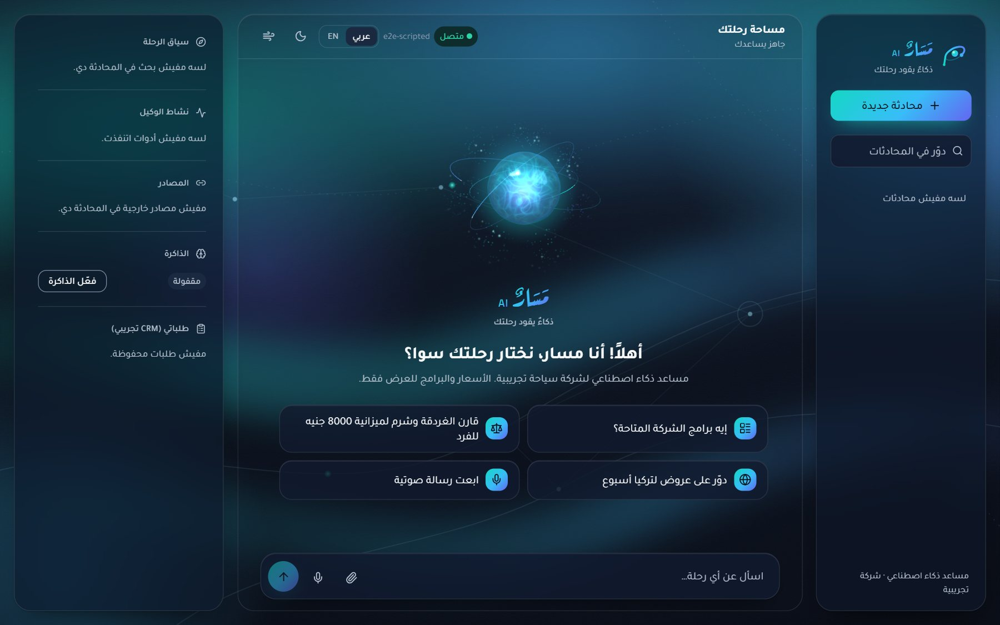
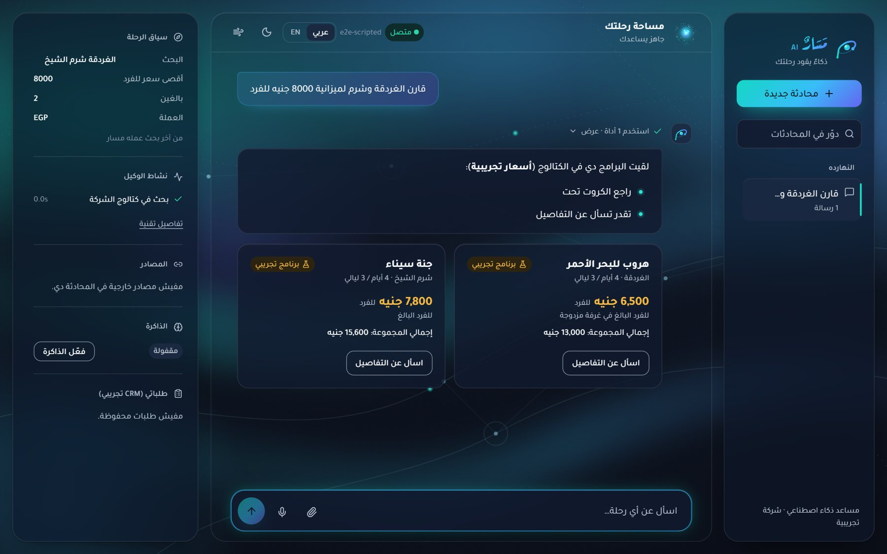
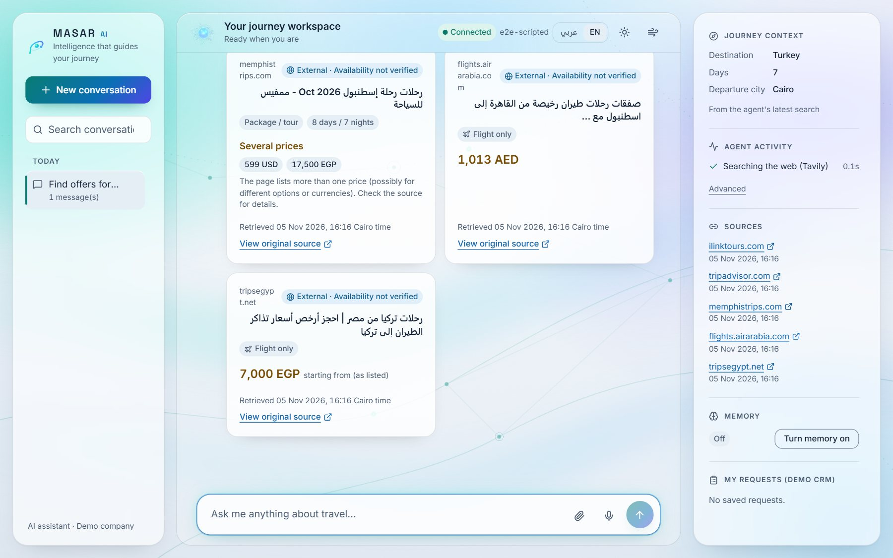
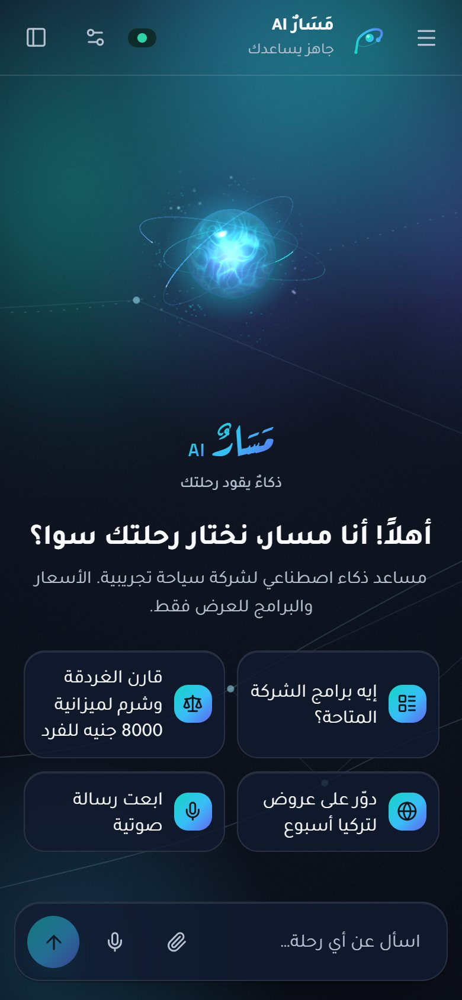
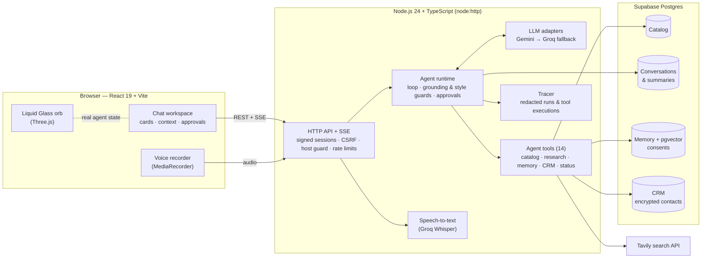

<div align="center">


# <span dir="rtl" lang="ar">مَسَارٌ</span> | MASAR AI

<p dir="rtl" lang="ar"><strong>ذكاءٌ يقود رحلتك</strong></p>

**An agentic AI travel assistant that researches, reasons and acts — in Egyptian Arabic, Modern Standard Arabic and English.**

Tool-calling agent · worldwide offer research · voice notes · consent-based memory · CRM approvals · Liquid Glass 3D interface


</div>

---

## Overview

MASAR AI is a standalone **agentic travel assistant** for a fictional demo travel company. It is not a scripted FAQ bot
and not a tourism website. Each customer message goes through a real agent loop:

1. The language model reads the conversation and the current context.
2. It decides which tools to call: catalog search, worldwide offer research, memory, CRM, …
3. The server validates every tool call and executes it against real data (Postgres, the Tavily search API, the
   customer's consented memory).
4. The model answers from those results. A grounding guard holds back answers that claim catalog facts without a
   lookup.
5. The browser streams every step as it happens, and the conversation and an observable trace are stored.

The company, its four travel programs and their prices are **demonstration data**. MASAR never confirms bookings,
availability or payments. External offers it finds on the web are shown as unverified listings with their source.

## Screenshots

<table>
  <tr>
    <td width="50%"></td>
    <td width="50%"></td>
  </tr>
  <tr>
    <td></td>
    <td align="center"></td>
  </tr>
</table>

<sub>Captured from the real application running against the project's deterministic test server (scripted model
replies and recorded search results). That is why the model label shows <code>e2e-scripted</code>.</sub>

## Features

### Agent

| Capability | Details |
|---|---|
| **Agent loop** | Multi-step function calling with bounded steps, a turn deadline, per-tool timeouts and cancellation. 14 tools with Zod-validated arguments. |
| **Free-tier LLM chain** | Google Gemini is primary (`gemini-3.8-flash` → `gemini-3.5-flash-lite`). Groq (`openai/gpt-oss-120b`) is the fallback, with client-side rate limits, cooldowns and per-call budgets. Paid providers are refused while `FREE_TIER_ONLY=true`. |
| **Company catalog** | Programs, prices, inclusions and departures live in Postgres; a new destination is a new row. Bilingual search (Arabic and English) with budget and currency filters. |
| **Worldwide research** | Tavily web search. Listings carry provider, https link, retrieval time (Cairo) and the status `listed_unverified`. A price is shown only when it appears literally in the source with its currency. |
| **Languages** | Egyptian Arabic, Modern Standard Arabic, English, mixed and Franco Arabic. A per-turn register hint and a style guard keep replies in the customer's language and register. |
| **Voice notes** | Recorded in the browser, transcribed by Groq Whisper (`whisper-large-v3-turbo`) and reviewed by the customer before sending. Unclear amounts in an unedited transcript are confirmed, not guessed. |
| **Memory (opt-in)** | Long-term preferences only after explicit consent (server-fixed wording). Semantic recall through pgvector (Gemini `gemini-embedding-001`, 1024 dims), with a trigram fallback. Customers can correct, forget or erase everything. |
| **CRM workflows** | Lead capture, quote requests and human handoff. Each action needs the customer's approval of a masked preview, bound to the exact arguments and usable once. Contact fields are encrypted with AES-256-GCM. |
| **Grounding and safety** | Grounding guard for catalog claims; style guard for language, register and tone. Web content is treated as untrusted data. The agent never claims bookings, payments or verified availability. |
| **Observability** | Every run is stored with model calls, tool executions (inputs redacted) and outcome. The browser receives real progress events over Server-Sent Events (SSE). |

### Interface

| Capability | Details |
|---|---|
| **Chat workspace** | React 19 console: conversation history, live tool activity, package and external-listing cards, a journey-context panel, sources, memory controls and CRM requests. |
| **Liquid Glass orb** | One Three.js canvas with a custom refraction and Fresnel shader, flowing energy filaments, orbit paths and particles. It reacts to real agent states (thinking, searching, listening, responding, error) and to the real microphone level. Quality tiers, a CSS fallback, context-loss recovery and reduced-motion support. |
| **Living Background** | CSS and SVG aurora, liquid ribbons, travel routes with moving points, and a network layer that brightens only while a tool really runs. |
| **Adaptive layout** | Panel modes based on the content width each mode needs (in em, so zoom and font size count). A size-container welcome screen; one scrolling region with the composer always reserved. |
| **Bilingual RTL/LTR** | Arabic-first typography (Tajawal, wordmark in Aref Ruqaa Ink) and English (Inter, Space Grotesk). Designed RTL lists, direction-aware composer, light and dark themes. |

**Not implemented:** spoken replies (text-to-speech), realtime voice conversation, real bookings or payments, and a
public hosted deployment.

## Architecture



**Request lifecycle**

1. The browser posts a message.
2. The server checks the session, origin and limits, then starts a run.
3. The runtime builds the prompt (stable instructions plus per-turn facts) and calls the model.
4. Tool calls are validated and executed, and their results go back to the model.
5. Write actions stop at an approval the customer must confirm in the UI.
6. The final answer passes the grounding and style guards.
7. Messages, the trace and the derived cards are stored, and the browser receives the final event and renders cards
   from the stored tool results.

## Technology stack

| Layer | Technology |
|---|---|
| Runtime | Node.js 24 (native TypeScript execution), TypeScript 7 (strict) |
| Server | `node:http`, Server-Sent Events, Zod 4, node-postgres 8 |
| AI providers | Google Gemini API (chat + embeddings), Groq (chat + Whisper), Tavily (search) |
| Database | Supabase Postgres 17, pgvector, pg_trgm, row-level security |
| Client | React 19, Vite 8, Tailwind CSS 4, Radix UI (dialog, dropdown), Motion 14, lucide-react |
| 3D | Three.js 0.187 (custom GLSL shaders, no post-processing) |
| Testing | `node:test`, PGlite + pgvector (in-memory Postgres), Playwright 1.64 |

## Getting started

### Requirements

- **Node.js 24 or newer** (the server runs TypeScript directly).
- A **Supabase** project (the free plan is enough). Use its **Session pooler** connection string.
- A **Google AI Studio** API key (free tier, in a project without billing).
- Optional: a **Groq** key (fallback model + voice notes) and a **Tavily** key (worldwide research, free plan).

### Install and configure

```bash
git clone https://github.com/Youssef-Elalfy/masar-ai-agent.git
cd masar-ai-agent
npm install
```

Create your local environment file. It is git-ignored; never commit it.

```bash
cp .env.example .env
```

On Windows PowerShell:

```powershell
Copy-Item .env.example .env
```

Fill in `.env` (see [Environment](#environment)), then check it. The checker reports status only, never values.

```bash
node scripts/env-check.mjs
```

### Database

Apply the schema (extensions, tables, row-level security), load the four demo programs, and verify (read-only):

```bash
npm run db:migrate
```

```bash
npm run db:seed
```

```bash
npm run db:check
```

### Run

Build the web client, then start the server. It serves the API and the built console at
**http://127.0.0.1:8787**.

```bash
npm run build:client
```

```bash
npm run web
```

For development with hot reload, keep `npm run web` running and start Vite on http://127.0.0.1:5173 (it proxies
`/api` to the server):

```bash
npm run dev:client
```

A terminal console is also available: `npm run chat`.

## Environment

Secrets are read **only by the server**. The browser never receives any environment variable.

| Variable | Required | Purpose |
|---|---|---|
| `DATABASE_URL` | Yes | Supabase Postgres Session-pooler connection string |
| `GEMINI_API_KEY` | Yes | Primary LLM and embeddings for semantic memory |
| `GROQ_API_KEY` | Optional | Fallback LLM and Whisper voice notes |
| `TAVILY_API_KEY` | Optional | Worldwide offer research (without it the agent says search is not connected) |
| `PII_ENCRYPTION_KEY` | Optional | 32-byte base64 key for encrypted CRM contact fields (CRM tools are disabled without it) |
| `WEB_SESSION_SECRET` | Recommended | ≥ 32-character secret signing the anonymous browser session cookie |
| `WEB_HOST`, `WEB_PORT` | Optional | Bind address (default `127.0.0.1:8787`) |
| `WEB_ALLOWED_HOSTS` | Optional | Extra host names to answer to behind a reverse proxy |
| `FREE_TIER_ONLY`, `GEMINI_MODELS`, `GROQ_MODEL`, `*_RPM`, `*_RPD` | Optional | Free-tier model chain and pacing |
| `AGENT_TIMEOUT_MS`, `PROVIDER_*_TIMEOUT_MS`, `TOOL_TIMEOUT_MS`, `MAX_AGENT_STEPS` | Optional | Agent limits |

The Supabase Data API keys (URL, publishable or anon key, secret or service-role key) are **not used**: the server
connects to Postgres directly.

## Demo travel programs

| Destination | Program | Duration | Price (demo) |
|---|---|---|---|
| Hurghada | Red Sea Escape | 4 days / 3 nights | 6,500 EGP per adult (double occupancy) |
| Sharm El Sheikh | Sinai Paradise | 4 days / 3 nights | 7,800 EGP per adult |
| Nubia (Aswan) | Nubian Heritage | 5 days / 4 nights | 9,200 EGP per adult |
| Fayoum | Fayoum Desert Adventure | 2 days / 1 night | 3,200 EGP per adult |

These programs, prices and the company itself are **fictional demonstration data**; booking is disabled.
External offers found by research are third-party listings: availability and final prices must be confirmed with the
provider.

## Security and privacy

- **Sessions and isolation:** signed, `HttpOnly`, `SameSite=Strict` anonymous session cookie. Every conversation,
  memory and CRM record is owner-scoped.
- **Request checks:** CSRF protection (custom header + same origin) and a host-name allowlist against DNS rebinding.
- **Browser hardening:** strict CSP (no inline scripts, no `eval`) and security headers.
- **Memory:** opt-in only, with recorded consent, audited saves and deletions, and erase-all.
- **CRM:** approvals bound to exact arguments, AES-256-GCM contact encryption, masked previews.
- **Untrusted content:** web results are sanitized and labelled. Prompt-injection text inside them is treated as data.
- **Database:** row-level security on every table, no grants to the public API roles.
- **Errors and logs:** generic errors to the browser (no stack traces or provider messages); traces redact personal
  data.

Report vulnerabilities privately: see [SECURITY.md](SECURITY.md). The latest audit is
[docs/FINAL_SECURITY_QA_REPORT.md](docs/FINAL_SECURITY_QA_REPORT.md).

## Testing

| Command | What it runs | Latest result (2026-11-05) |
|---|---|---|
| `npm run check` | Typecheck (server, client, E2E) + unit/integration tests | **191 passed**, 0 failed, 0 skipped |
| `npm run e2e` | Playwright on desktop Chrome and Pixel 7 against a deterministic test server (real HTTP, agent, tools and SQL; scripted model, recorded search results, fake speech-to-text) | **62 passed**, 0 failed, 10 skipped by design (desktop-only or mobile-only checks) |
| `npm run build:client` | Production build | Passes |
| `npm audit` | Dependency vulnerabilities | 0 |
| `node scripts/secret-scan.mjs` | Secret scan of all text files and the built client | Clean |

Live checks against the real providers (`npm run live:smoke`, `research:check`, `crm:check`, `voice:check`) use free
quota and require `--confirm`. Their recorded results are in
[docs/MASAR_TRANSFORMATION_REPORT.md](docs/MASAR_TRANSFORMATION_REPORT.md).

## Known limitations

- **Free-tier latency:** turns often take 30–100 s, and quotas limit heavy use.
- **Groq fallback:** within its free tokens-per-minute limit it can serve single-step turns, not full multi-step agent
  turns.
- **Voice:** speech recognition can mis-hear amounts in mixed Arabic/English speech; the agent asks for confirmation.
  There is no spoken reply.
- **Travel data:** availability and prices of external offers are never guaranteed. The company and its catalog are
  fictional.
- **Deployment:** runs locally; there is no public hosted deployment yet.
- **Not tested yet:** a real screen reader, the browser's own zoom control, iOS Safari on a device, and
  Firefox/Safari rendering of the glass shader.

## Roadmap

**Delivered**

- **M1–M2:** agent loop, Supabase catalog, opt-in memory with pgvector.
- **M3–M5:** worldwide research, CRM approvals, voice notes.
- **M6:** web console, followed by the MASAR rebrand, the Liquid Glass orb, the adaptive layout, and a security and QA
  audit.

**Planned**

- **M7:** evaluation and documentation package.
- **AI Automation** (postponed): workflow automation around the agent. Not implemented.
- **Deployment:** a hosted demo with a least-privilege database role.

## License and credits

The original code and assets are released under the [MIT License](LICENSE).

Third-party libraries and fonts keep their own licenses: React, Three.js, Motion, Radix UI and Zod (MIT), Lucide
icons (ISC), and Tajawal, Inter, Space Grotesk and Aref Ruqaa Ink (SIL OFL 1.1). The simplex-noise GLSL in the orb
is adapted from webgl-noise (MIT). See [THIRD_PARTY_NOTICES.md](THIRD_PARTY_NOTICES.md).

## Author

**Youssef Mohamed Elalfy** · GitHub: [@Youssef-Elalfy](https://github.com/Youssef-Elalfy)

Built as an AI engineering project with a focus on trustworthy, observable agents for Arabic-speaking users.
