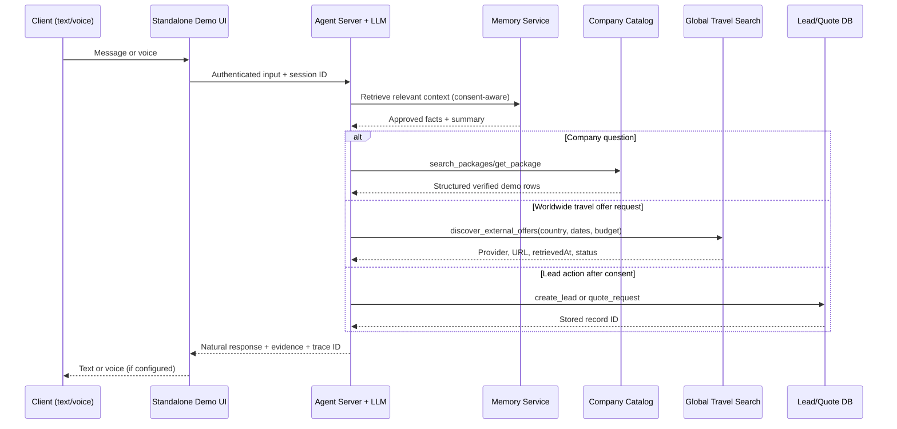

# Technical Architecture — Agent Runtime (not a tourism website)

## Stack decision
- **Primary language:** TypeScript (strict), Node.js 20+ or installed active LTS supported by verified libraries, Zod validation.
- **Server:** Fastify or similarly lean typed Node API; OpenAI Agents SDK for the first integrated agent loop because it supports functions, sessions, tracing and realtime voice. Run actual tests against current SDK; do not assume alternate LLMs work automatically. Model adapter for future Anthropic provider is a separately verified integration.
- **Database:** PostgreSQL (Supabase hosted as practical option), migrations with schema and safe RLS, pgvector only where semantic retrieval adds value.
- **UI:** minimal React + Vite + TypeScript chat/voice console; no Next.js marketing site, no 3D cinematics, no hero.
- **Knowledge:** structured SQL for company package facts and prices; RAG only for long descriptions/FAQs/policies; web provider for external itineraries.
- **Voice:** STT -> same agent runtime -> TTS; optional Realtime layer later with ephemeral credentials and shared tool/security logic.
- **Validation/testing:** Vitest, Playwright; optional mock recording; all Node-friendly (no Python dependency).

## Runtime sequence


## Domain services / folders proposed for implementation
```
server/src/
  api/{routes,middleware,schemas}
  agent/{runtime,providers,policy,tool-registry,tool-loop}
  tools/{catalog,comparisons,travel-web,places,crm,quote-request,handoff}
  memory/{sessions,episodic,profiles,embeddings,privacy}
  voice/{stt,tts,realtime,transcripts}
  db/{client,migrations,repositories,seed}
  observability/{tracing,redaction,metrics}
  security/{permissions,rate-limit,prompt-injection}
client/src/{components,features-chat,features-voice,i18n}
```

## Tool execution loop
User asks goal -> model infers next step -> validates typed tool input with Zod -> policy/approval gate -> tool reads/writes via service layer -> tool returns structured source/provenance -> model decides next step or final response. Max iterations and timeout; append tool results to session; never string-interpolate untrusted web text as system prompt. Only allowlisted tool names and server-controlled credentials.

## Traceability
Each run: requestId, sessionId pseudonymous, model provider/model ID, tool name, arguments with PII redacted, source IDs, timings, result types, error codes, consent status, tokens/cost, final result status. Keep private chain-of-thought hidden.

## Hard failure cases
- Timeout / rate limit / unavailable provider -> fallback only to verified connected provider or a graceful transparent service message; no fabricated result.
- Search source returns stale price -> label indicative/last seen and request live confirmation.
- No company package -> say none verified in company catalog; optionally expand world search.
- No user consent -> do not persist phone or unsolicited profile.
- Attack text inside external web page -> treat as data, not instructions.

## Deployment
UI may deploy to Vercel as a thin client only if necessary; persistent voice WebSocket/service likely requires separate appropriate always-on hosting. The user requested **no tourism website**, so a cloud-hosted demo console is not equivalent to adding a marketing website.
