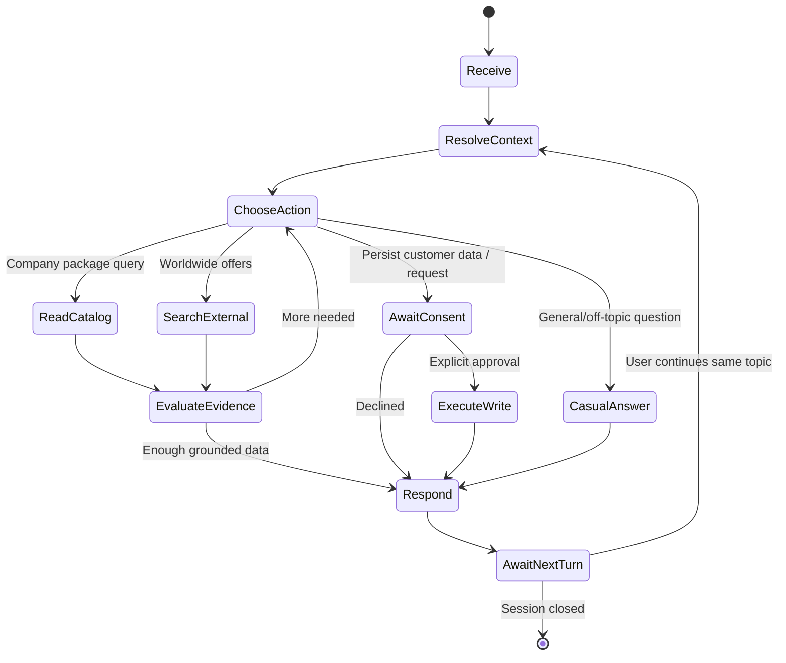

# تحليل النظام وتحليل السلوك المطلوب للتسليم للدكتور

## 1. Problem statement
شركات السياحة تكرر الإجابة عن أسعار ومدد البرامج. أنظمة FAQ غير قادرة على التعامل مع الأسئلة المركبة وتفضيلات العملاء أو البحث عن عروض خارج قائمة محدودة. الحل المقترح وكيل AI متخصص يستطيع تشغيل أدوات وتخطيط خطوات محددة وليس مجرد نصوص ثابتة.

## 2. Stakeholders
عميل يبحث عن رحلة؛ موظف سياحة يتلقى بيانات/طلبات؛ مشرف تقني يراجع Trace والصلاحيات؛ مدرس يقيم أن السلوك Agentic بالفعل.

## 3. Inputs / Outputs
Input: Text/Voice، لغة العميل، قائمة برامج شركة افتراضية، طلب بحث عالمي، قيود الميزانية والتواريخ وطلبات حفظ البيانات. Output: رد طبيعي، مقارنة موثقة، عروض بمصادر، طلب اهتمام محفوظ بموافقة، Trace قابل للفحص.

## 4. Agent behavior state machine

## 5. Behavioral rules examples
- «بكام رحلة الفيوم؟» -> DB query, demo price and days exact, disclaimer.
- «معايا 7000» -> DB filters plus computed comparisons; check per-person assumption.
- «طب لو تركيا؟» -> resolve travel intent, look in company, research outside company, source attribution.
- «أنا اسمي...» -> do not save to persistent CRM until consent/purpose made clear.
- «إنت غبي» -> friendly repair question, not error or threat.
- «علمني React» then 10 follow-ups -> natural programming conversation; no travel interruptions.
- «خلاص شكرا» -> optional gentle travel return if not repeated, not forced.
- «مش فاكر؟» -> retrieval of authorized memory or transparent inability, not false memory.

## 6. Falsifiable evidence of agenticity
Record actual tool invocation and result IDs for queries; DB change when creating a lead after approval; selection of tools in varied multi-step utterances; memory recall across sessions; external search citation + freshness; recovery after tool failure. Screenshots/log snippets alone without repeatable tests are insufficient.

## 7. Academic deliverables
Problem/goal, system context diagram, Use Case diagram, Sequence diagram, state diagram, architecture and data ERD, behavior analysis matrix, privacy/permissions design, tool schemas, before/after tool traces, test report with pass/fail, demo script and limitations.

## 8. Limitations to disclose
No universal world travel database; external package coverage depends on provider, licenses and access. A general language model cannot guarantee every answer correct. Voice dialects/noisy audio vary. Sandbox/mock prices and packages are not bookable. Live ticketing requires integrations/authorization and is not implicitly present.
